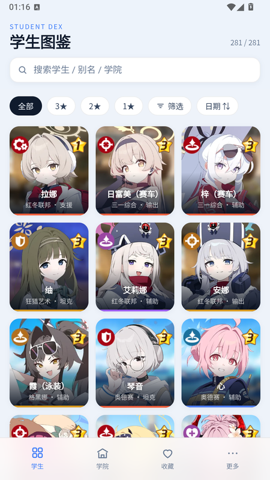
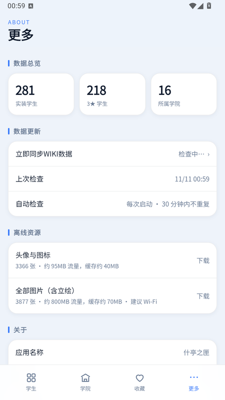
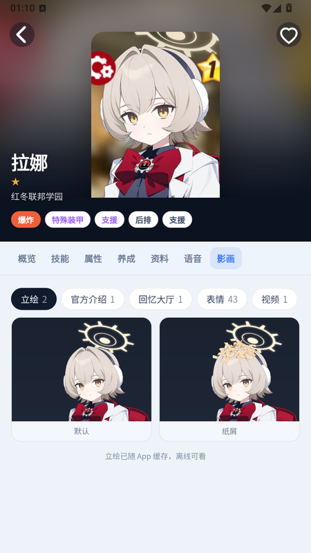

# Android 端复核与验证报告（1.0.2）

- 验证环境：雷电模拟器 LDPlayer14，Android 14（API 34），系统 WebView 146，900×1600 @320dpi（dpr=2）
- 结论：**1.0.2 可安装、可离线（缓存后）、支持应用内更新**；release 签名产物已发布。

---

## 1. 产物

| 项 | 值 |
| --- | --- |
| Release APK | `dist/StudentDex-1.0.2-android.apk`（14,220,107 字节） |
| SHA-256 | `0ab8399e8016266b2074439aa38f36643fc225a259785e015e13c7e78f661e45` |
| 包名 / 版本 | `com.sensei.studentdex` / versionName `1.0.2`、versionCode `2` |
| SDK | minSdk 24，targetSdk 35，compileSdk 35 |
| 签名 | release keystore（`CN=StudentDex, OU=Android, O=StudentDex`），APK Signature Scheme v2 |

APK 只含核心页面（`index.html`/`app.js`/`styles.css`/`data.js`/`asset-map.json`），图片不打包。

## 2. 构建

```bash
cd android
D:/harness/.build-env/gradle-8.14.5/bin/gradle.bat :app:assembleRelease
D:/leidian/LDPlayer14/adb.exe install -r app/build/outputs/apk/release/app-release.apk
```

## 3. 验证矩阵（模拟器实测）

| # | 项 | 动作 | 结果 |
| --- | --- | --- | --- |
| 1 | 冷启动 | force-stop 后 `am start -W` | 1.0–1.7s 显示列表 |
| 2 | 图片按需回源 | 首次进入列表 | 头像从 gamekee CDN 取原图，压成 360px WebP（约 30KB），滚动即出 |
| 3 | 映射就绪 | 冷启动立即进列表 | 3 秒 ready latch 后不再出现「首屏永久缺图」 |
| 4 | 缓存 | `files/ba-assets` | 命中后秒开；文件无扩展名、内部存储、含 `.nomedia` |
| 5 | 一键下载 · 头像与图标 | 更多 → 离线资源 → 下载 | 3366 张，约 4 分钟，实测 12.6 张/秒；完成 3363 张、失败 3、缓存 133.5MB |
| 6 | 一键下载 · 全部（含立绘） | 点一次 | 按钮变「再点一次确认 500MB」，6 秒无操作自动恢复 |
| 7 | 取消 / 续传 | 运行中点取消，再点开始 | 状态「已取消 · 已缓存 226 张 · 5.1MB」；再次开始跳过已缓存 |
| 8 | 离线 | CDP 断网后重载 | 列表与已缓存图片正常显示，角标/收藏不受影响 |
| 9 | 影画卡片 | 详情 → 影画 → 立绘 | 修复上游 flex 行布局导致标题竖排的问题（注入 `.mcard{flex-direction:column}`） |
| 10 | 立绘透明通道 | 影画 → 立绘 | 合成深色渐变后 JPEG，无黑底；头像用 WebP 保留 alpha |
| 11 | 返回键 | 详情/筛选/根 | 关详情、关面板、根退出，均正常 |
| 12 | 触摸滚动 | 手指上/下滑 | 正常（含 `html{overflow:visible}` 修复） |
| 13 | 深色模式 | `cmd uimode night yes/no` | 页面/状态栏/窗口背景同步，无重载 |
| 14 | 同步/更新桥 | 更多页 | WIKI 同步「更新 5 名」；GitHub 更新检查经桥返回 |
| 15 | 外链 | 资料页来源链接 | 系统浏览器打开，App 停留 |
| 16 | 自更新 | `update.js` 选择逻辑 | 只挑 `android-v*` 且含 `.apk` 的 release，返回 apk 直链；`.apk` 外链走原生下载+安装 |
| 17 | 图标 | 桌面 | 自适应图标（蓝底 + 角色前景），圆角遮罩完整 |

| 列表（按需回源） | 离线资源入口 | 影画页 |
| --- | --- | --- |
|  |  |  |

## 4. 1.0.2 关键改动

1. **素材外置**：`avatars/img/portraits` 不再打包，`asset-map.json`（3877 条，465KB）把本地路径映射回 gamekee 源 URL；`PathHandler` 先查缓存、再回源、最后回落 APK。
2. **图像处理**：头像 360px WebP q80（保留 alpha）；立绘 480px，先合成 `#1A2230→#242E40` 竖直渐变再 JPEG q82（对齐原 `crawl/portraits.py`）；图标原样。
3. **并发**：回源信号量 6 → 20；连续 5 次失败自动降到 8；批量下载 12 worker。
4. **一键离线**：`basic`（头像+图标，3366 张）与 `all`（3877 张，含 511 张立绘）；空间检查 300MB、取消、跳过已缓存。
5. **自更新**：`update.js` 指向本仓库，筛选 Android release 的 APK 资产；原生下载后用 `FileProvider` 拉起安装器。
6. **上游同步**：合并 upstream 5 个提交（影画分页、语音改版、媒体缓存 `op:"cache"`），Android 侧实现 `cache` 的 set/get/size/clear（与 iOS 同 FNV-1a 命名）。

## 5. 已知限制

1. **首次浏览需联网**：冷缓存下首屏约 8–12 秒铺满（CDN 单张 200KB 级 + 20 并发），之后走缓存瞬开。
2. **全量很重**：`all` 约 500MB 流量（立绘 511 张、单张 ~630KB），缓存约 165MB；建议 Wi-Fi。
3. **依赖 gamekee CDN**：网络不可达时新图片 404（已缓存不受影响）；本机网络对 `www.gamekee.com` 时通时断。
4. **一键下载需前台**：未做前台 Service，切后台可能被系统暂停；重进后再次点击会续传。
5. **失败项**：实测 3366 张中 3 张失败（CDN 偶发），UI 显示「失败 3」，再次下载会重试。
6. debug 包与 release 包签名不同，覆盖安装需先卸载；卸载会清空缓存。
7. iOS 侧未改动（含图标），本项目只维护 Android port。

## 6. 后续建议

- 首次启动预热前 1–2 屏头像（约 60 张 / 12MB），把首屏压到 2–3 秒。
- 失败重试队列（自动重试 1 次）。
- GitHub Actions：`assembleRelease` + Secrets 签名，Release 自动附 APK。
